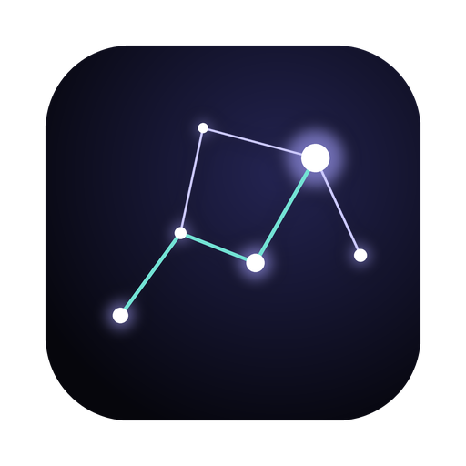
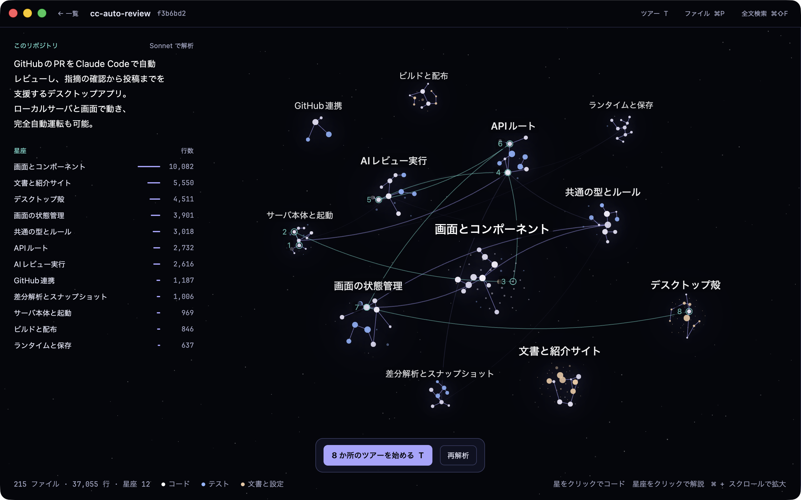
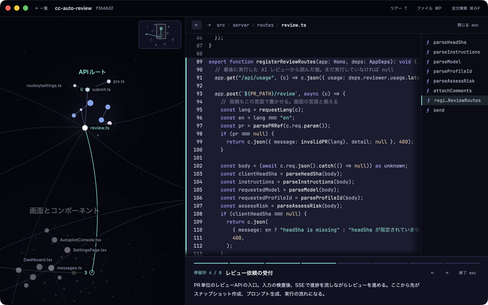
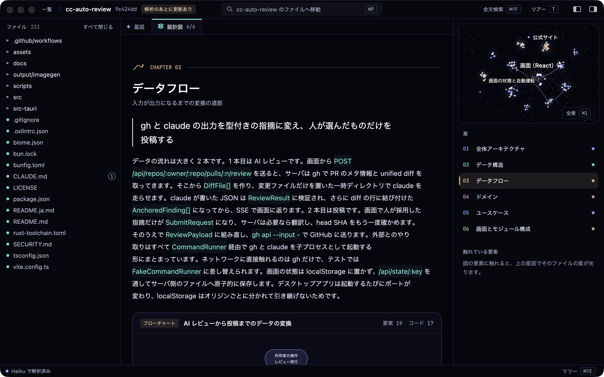
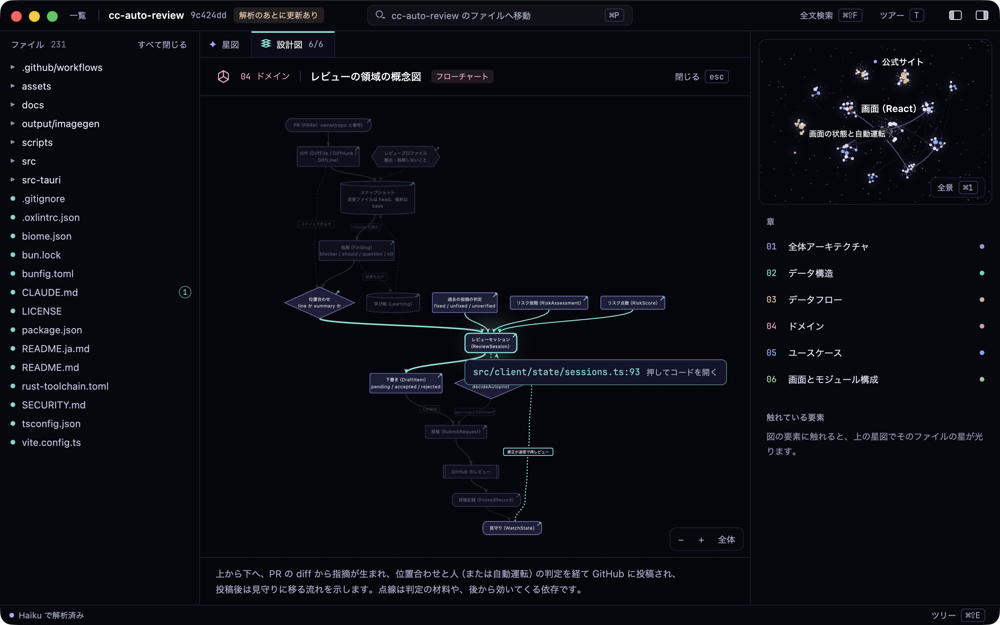
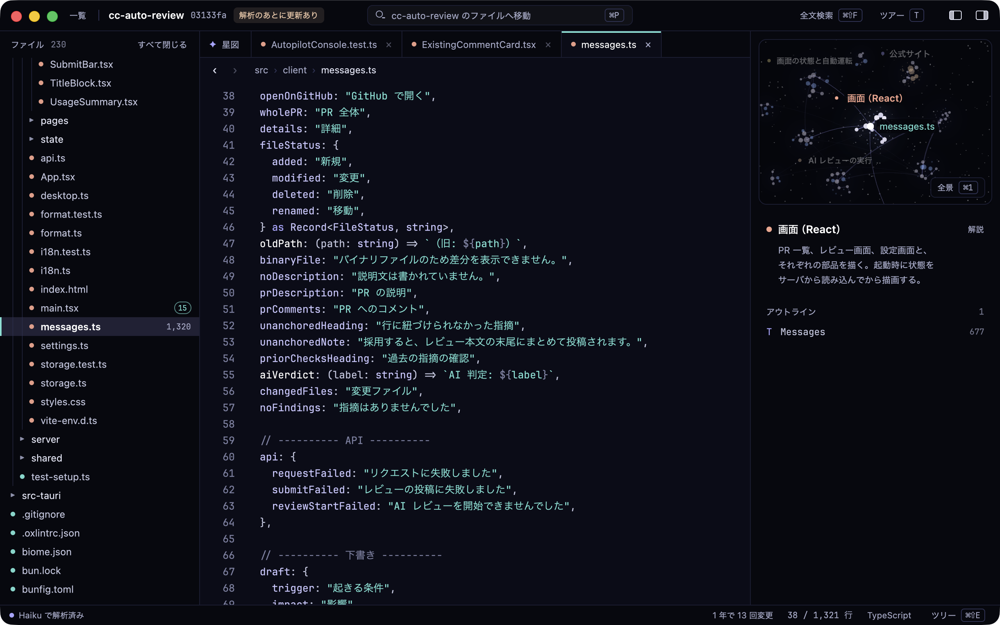

<div align="center">
  

  <h1>CC Code View</h1>

  <p>
    <strong>初めて見る大きなコードベース、どこから読めばいいか迷っていませんか？</strong>
  </p>
  <p>
    リポジトリを星図にして、Claude Code に読む順番を案内させる macOS アプリを作りました。
  </p>
  <p>
    ファイルが星に、モジュールが星座になり、手元の <code>claude -p</code> が星座に名前を付けてガイドツアーを組みます。コードはファイルツリーとタブのある普通のビューアーで読めて、いま読んでいるファイルが全体のどこにあるかを星図がいつも示します。
  </p>

  <p>
    <a href="#-機能"></a>
    <a href="#-インストール"></a>
    <a href="#-使い方"></a>
    <a href="#-開発"></a>
  </p>
  <p>
    
    
    
    
    <a href="LICENSE"></a>
  </p>

  <p><a href="README.md">English README</a></p>

  <p>⭐ <strong>知らないコードベースを読む助けになったら、スターをもらえると他の人にも届きやすくなります。</strong><br>
  更新情報は X の <a href="https://x.com/kara_mage">@kara_mage</a> で流しています。</p>
</div>

<p align="center">
  
  <br>
  <sub>全景。Claude が名付けた星座、ツアーの航路、星座の一覧。</sub>
</p>

> [!NOTE]
> Anthropic とは関係のない個人のプロジェクトです。Claude は Anthropic, PBC の商標です。

## 🌟 概要

新しいプロジェクトに入ったとき、難しいのはファイルを読むことより、どのファイルから読むか、それが全体とどうつながるかを知ることです。CC Code View はこの 2 つに 1 枚の絵で答えます。

星図は AI を使わずに数秒で描きます。星の大きさがコード量、明るさが変更頻度、線が依存関係です。そのうえで Claude がモジュールを星座としてまとめて名前と説明を付け、読む順番にガイドツアーの停留所を選びます。

コードを読む画面は、ファイルツリー、タブ、パンくず、シンタックスハイライトがある普段のエディターに近い形です。右の小さな星図が、いま開いているファイルの位置を示し続けます。

すべて手元の Mac と、インストール済みの Claude Code で動きます。Claude Code が無くても星図とコード表示は使えます。

## 🆚 ほかの方法との違い

| | CC Code View | チャットの AI に聞く | エディターで読む |
|---|---|---|---|
| 全体像 | 全ファイルの地図。大きさ、変更頻度、依存関係が見える | 文章の要約を頭の中で組み立てる | フォルダーのツリー |
| どこから読むか | 順番付きのガイドツアー。解説がコードの横に出る | 聞き方しだい | 自分で決める |
| いまどこにいるか | 読んでいるファイルが地図上で光る | 何往復かすると見失う | ファイルパスだけ |
| リポジトリに対する安全性 | Claude は空の一時ディレクトリで読み取り専用。リポジトリ内のフックや `.mcp.json` は読まない | ツールしだい | 該当なし |

## 📋 目次

- [🌟 概要](#-概要)
- [🆚 ほかの方法との違い](#-ほかの方法との違い)
- [✨ 機能](#-機能)
- [🚀 インストール](#-インストール)
- [📖 使い方](#-使い方)
- [⌨️ キー操作](#️-キー操作)
- [🏗 仕組み](#-仕組み)
- [🔒 セキュリティ](#-セキュリティ)
- [⚡ 性能](#-性能)
- [🛠 開発](#-開発)
- [🤝 コントリビュート](#-コントリビュート)
- [📄 ライセンス](#-ライセンス)
- [🙏 謝辞](#-謝辞)

## ✨ 機能

### 🌌 リポジトリの星図

星の大きさはコードの行数、明るさは直近 1 年の変更回数、線はファイル間の import です。集計、配置、依存の解決は手元で動き、生成した 12,000 ファイルのリポジトリでも数秒で描けます。`⌘` + スクロールで拡大でき、星をクリックするとコードが、星座名をクリックすると星座の解説が開きます。

### 🧭 Claude によるガイドツアー

Claude がファイルをモジュールごとの星座にまとめ、名前と役割の説明を付けます。`T` でツアーを始めて `←` `→` で進むと、星図のカメラ、コード、解説が一緒に動きます。

星座を開いて「解説を生成」を押すと、そのモジュールのくわしい解説を作って保存します。AI を実行するすべての場所で、Claude の既定、Fable、Opus、Sonnet、Haiku からモデルを選べます。

<p align="center">
  
  <br>
  <sub>ツアーの停留所。星図、コード、解説が同期します。</sub>
</p>

### 📐 図で読む設計図

ツアーはどこから読むかを教えます。設計図は、そのシステムがどう組み立てられているかを教えます。Claude が観点ごとに 1 章ずつ書き、章には図と要点と、根拠にしたコードの行が付きます。

| 章 | 答える問い | おもな図 |
|---|---|---|
| 全体アーキテクチャ | どんな部品が、どの向きに依存しているか | subgraph で層を分けたフローチャート |
| データ構造 | 中心になる型と、その持ち物と関係 | クラス図、ER 図 |
| データフロー | 入力が出力になるまでの変換の道筋 | 変換の段を並べたフローチャート、シーケンス図 |
| ドメイン | 扱っている問題の言葉と決まりごと | 概念図、状態遷移図、用語集 |
| ユースケース | 使う人から見て、何ができるか | 利用者とユースケースの図、シーケンス図 |
| 画面とモジュール構成 | 画面とモジュールの分け方と行き来 | モジュールの図、画面の遷移 |

- 図は Mermaid（flowchart、sequenceDiagram、classDiagram、erDiagram、stateDiagram-v2）で書かれます。アプリが自分で解析して配置し、gpui で描くので、Web ビューは使いません。
- 要素に触れると、つながる線が灯り、データの向きに光の粒が流れます。`↗` の付いた要素を押すとそのファイルが開き、星図ではそのファイルの星が光ります。`⌘` + スクロールで拡大、ドラッグで移動、「拡大」で図を画面いっぱいに広げられます。
- 要点には、Claude が読んだという行の範囲が付きます。リポジトリに無い範囲は捨てます。押すとその行を開きます。文中のコードの名前には色が付きます。
- 章は 3 つずつ並べて書き、書けた章から現れます。章ごとに描き直せます。Mermaid として読めない図は、解析器のエラーを添えて Claude に書き直させてから保存します。
- フローチャートは、縦横の向きを入れ替えたほうが本文の幅で大きく読めるときは、向きを変えて表示します。本文の幅では読めないほど大きな図には「拡大して読む」を出します。

<p align="center">
  
  <br>
  <sub>設計図の章。右には章の一覧と星図。</sub>
</p>

<p align="center">
  
  <br>
  <sub>拡大した図。線のラベルは段から段へ渡す値の型です。</sub>
</p>

### 📖 現在地が分かるコードビューアー

- ファイルツリーは読んでいるファイルまで自動で開きます。点の色は所属する星座の色で、ツアーの停留所には番号が付きます。
- タブは戻ると読んでいた位置から再開し、パンくずの末尾にはいま読んでいる関数の名前が出ます。
- 右のパネルに、現在のファイルの星と星座、星座の説明、関数と型のアウトラインを出します。
- ハイライトは Rust、TypeScript、JavaScript、Python、Go と、JSON、TOML、YAML、CSS、シェル、Markdown に対応しています。ファイル内検索、行への移動、`⌘` + クリックの簡易な定義ジャンプ、移動履歴、行の選択とコピーもできます。

<p align="center">
  
  <br>
  <sub>コードを読む画面。ファイルツリー、タブ、現在地の星図。</sub>
</p>

### 🔎 検索

ファイル名のあいまい検索（`⌘P`）と全文検索（`⌘⇧F`）ができます。

### 🖥 小さくて速いネイティブアプリ

アプリは約 12 MB で、約 150 ms で起動し、60 fps で描画します。Zed エディターの UI フレームワークである [gpui](https://github.com/zed-industries/zed/tree/main/crates/gpui) と Rust で作っています。

## 🚀 インストール

### 必要なもの

- macOS 13 以降（Apple Silicon で確認）
- [Rust](https://rustup.rs) stable。gpui の `runtime_shaders` 機能を使うので Metal Toolchain は不要です。
- AI 機能を使う場合は、`--restricted` に対応した [Claude Code](https://claude.com/claude-code)（2.1.319 で確認）。無くても星図とコード表示は使えます。

### ソースからビルド

```bash
git clone https://github.com/karamage/cc-code-view.git
cd cc-code-view
scripts/bundle.sh   # target/CC Code View.app を作る
```

できた `target/CC Code View.app` を `/Applications` にドラッグします。

> [!IMPORTANT]
> アドホック署名のみで、公証はしていません。macOS に開くのを拒否されたら、**システム設定 → プライバシーとセキュリティ → このまま開く** で許可してください。

## 📖 使い方

```
リポジトリを登録 → 星図を見る → AI 解析 → ツアー → 自由に読む
```

1. ホーム画面の「登録」を押すか、フォルダーをウィンドウにドロップしてリポジトリを登録します。手元の Git リポジトリならどれでも使えます。
2. 数秒で星図が出ます。ここまで AI は使っていないので、ツリーや星図からすぐにファイルを開けます。
3. 星図のタブでモデルを選んで `Enter` を押すと AI 解析が始まります。Claude がリポジトリを読み、星座の名前とツアーを作ります。読んでいるファイルが進捗に出ます。
4. `T` でツアーを始め、`←` `→` で進みます。`esc` で終わります。
5. 「設計図」のタブ（`⌘2`）でモデルを選び、「設計図を描く」を押します。書けた章から現れます。
6. 右の星図が現在地を示し続けるので、あとは自由に読めます。解析のあとにリポジトリが更新されるとタイトルバーに表示が出て、再解析できます。

## ⌨️ キー操作

| キー | 動作 |
|---|---|
| `⌘P` / `⌘⇧F` | ファイル検索 / 全文検索 |
| `⌘F`、`⏎` `⇧⏎`、`esc` | ファイル内検索、次と前の一致、閉じる |
| `⌘L` / `⌃G` | 行へ移動 |
| `⌘⇧E`、`↑` `↓` `←` `→` | ファイルツリーへ移り、矢印で移動と開閉 |
| `⌘W`、`⌃⇥` `⌃⇧⇥` | タブを閉じる、タブを切り替える |
| `⌘1` / `⌘2` | 星図のタブ / 設計図のタブへ |
| `⌘B` / `⌘⇧L` | ファイルツリー / 右のパネルの表示切り替え |
| `Enter` | AI 解析を開始（星図のタブで） |
| `T`、`←` `→`、`esc` | ツアーの開始、移動、終了 |
| `⌘` + スクロール、`⌘=` `⌘-` `⌘0` | 星図や図のズーム、全景に戻す |
| `esc` | 拡大した図を閉じる |
| `⌘` + クリック | 定義へ移動 |
| `⌘[` `⌘]`、`‹` `›` ボタン | 移動履歴を戻る、進む |
| ドラッグ、`⌘C` | 行を選択、コピー |
| `⌘⇧O` | リポジトリ一覧へ戻る |

## 🏗 仕組み

```
CC Code View.app
├── ccv-core   リポジトリの走査、シンボル抽出、import の解決、git の変更頻度、
│              グループ分け、星の配置、ハイライト、検索、保存、Mermaid の解析と配置
├── ccv-ai     claude -p を読み取り専用で動かし、構造化出力を検証する
└── app        gpui の画面（ホーム、ワークスペース、ツリー、コード、星図、ツアー）
```

星図は `ccv-core` だけで作ります。ファイルの走査、シンボル抽出、import の解決、`git log` による変更頻度、決定的な配置です。

AI 解析では、Claude にプロンプトと JSON スキーマを渡します。結果はリポジトリと突き合わせ、存在しないファイルを指す星座や停留所は捨てます。設計図は章ごとに 1 回ずつ `claude -p` を動かします。図の Mermaid はアプリの解析器で確かめ、読めない図はエラーを添えて 1 回だけ書き直させます。図の要素とファイルの対応や、根拠の行もリポジトリと突き合わせます。図の配置は階層型（閉路の除去、階層の決定、subgraph をまとめたままの交差の削減、二次の最適化による位置決め、曲線の線）で、シーケンス図は列と行で配置します。

解析結果は解析したときのコミットと一緒にリポジトリごとに保存します。開き直しはすぐに終わり、その後にコードが更新されたことも分かります。

## 🔒 セキュリティ

クローンしたリポジトリは信頼できない入力として扱います。

1. Claude は空の一時ディレクトリで動かし、リポジトリは `--add-dir` で渡します。使えるツールは `Read`、`Grep`、`Glob` だけで、書き込みとコマンド実行はできません。これらのディレクトリの外への読み書きも遮断します。
2. `--restricted` と `--strict-mcp-config` により、リポジトリ内の `.claude/` のフックや `.mcp.json` は読み込まれません。
3. 読まれたファイルは Anthropic の API に送られるので、`.env`、秘密鍵、認証情報のファイルは読ませません（一覧は [`crates/ai/src/command.rs`](crates/ai/src/command.rs)）。ファイル名で判定するため、別の名前で置かれた秘密情報は防げません。
4. AI の出力は検証し、リポジトリに無いファイルを指す項目は捨てます。文章は書式なしで表示し、残す書式はコードの名前を囲むバッククォートだけです（色を付けます）。Mermaid はアプリの解析器で読み、`click`、リンク、`style`、`classDef`、`%%{init}%%` は無視し、ラベルの HTML は `<br>` 以外を取り除き、図の大きさにも上限を設けます。ブラウザやスクリプトの実行環境には何も渡しません。
5. 登録したリポジトリには何も書き込みません。データは `~/Library/Application Support/cc-code-view/` に置きます。
6. アプリ自身は通信せず、利用状況も送りません。AI 解析はインストール済みの `claude` コマンドを通します。

隔離は実際の `claude` を使うテストで確認しています。

```bash
cargo test -p ccv-ai --test security -- --ignored   # 実際の claude を使い、利用枠を少し消費する
```

脆弱性の報告は [SECURITY.md](SECURITY.md) を見てください。

## ⚡ 性能

Apple M1 で `scripts/measure.sh` を使って測りました（[詳細](docs/quality/performance.md)）。12,000 ファイルのリポジトリは依存をランダムにつないで生成したもので、実際の大規模リポジトリではまだ測っていません。

| 指標 | 実測 |
|---|---|
| コールドスタート | 約 150 ms |
| 12,000 ファイルの集計（生成したリポジトリ） | 1.5 秒 |
| アプリのサイズ | 12 MB |
| 12,000 ファイル表示中のメモリ（生成したリポジトリ） | 169 MB |
| フレーム時間 | p50 16.7 ms、p99 17.7 ms（60 fps） |

## 🛠 開発

### 技術スタック

- 言語は Rust（edition 2024）
- UI は [gpui](https://github.com/zed-industries/zed/tree/main/crates/gpui)
- AI は [Claude Code](https://claude.com/claude-code)（`claude -p` の構造化出力）

### 構成

```
cc-code-view/
├── crates/
│   ├── core/      # 集計、依存、変更頻度、グループ分け、配置、ハイライト、検索、保存
│   ├── ai/        # claude の実行、プロンプト、スキーマ、検証、セキュリティテスト
│   └── app/       # gpui の画面（ホーム、ワークスペース、ツリー、コード、星図、ツアー）
├── scripts/       # バンドル、画面撮影、実入力での操作、性能測定
└── docs/          # 画像、品質の基準と記録、設計と計画
```

### コマンド

```bash
cargo test --workspace
cargo clippy --workspace --all-targets -- -D warnings
scripts/bundle.sh                            # .app を作る
scripts/capture.sh <出力先> <リポジトリ>      # 全状態を撮影（BIN=target/debug/cc-code-view で開発版を使う）
scripts/drive-viewer.sh <出力先> <リポジトリ> # ツリー、検索、行移動を実際の入力でたどる
scripts/drive-blueprint.sh <出力先> <リポジトリ> # 図の要素に触れ、押してコードを開く操作を実際の入力でたどる
scripts/measure.sh [リポジトリ]               # 性能を実測
```

## 🤝 コントリビュート

Issue と Pull Request を歓迎します。PR の前に `cargo test --workspace` と `cargo clippy` を通してください。

特に手を借りたいところは次のとおりです。

- 🐛 不具合の報告と修正
- 🎨 ほかの言語のハイライトと import の解決
- 🌐 英語の UI（いまの UI は日本語のみ）
- 🐧 Linux と 🪟 Windows への対応
- 📦 署名と公証をした配布版

## 📄 ライセンス

MIT。[LICENSE](LICENSE) を見てください。

同梱の JetBrains Mono は SIL Open Font License（[`crates/app/assets/fonts/OFL.txt`](crates/app/assets/fonts/OFL.txt)）です。入力部品は gpui の例（Apache-2.0、[`LICENSES/`](LICENSES/)）を元にしています。ホーム画面の星雲は画像生成で作りました。

## 🙏 謝辞

- 星座に名前を付け、ツアーを組む Anthropic の [Claude Code](https://claude.com/claude-code)
- Rust で速いネイティブ UI を作れるようにしてくれた Zed Industries の [gpui](https://github.com/zed-industries/zed/tree/main/crates/gpui)
- [JetBrains Mono](https://github.com/JetBrains/JetBrainsMono)
- 姉妹アプリの [CC Auto Review](https://github.com/karamage/cc-auto-review)。Claude Code で Pull Request をレビューします。

---

<div align="center">
  <a href="https://github.com/karamage/cc-code-view/issues">不具合の報告</a>
  ·
  <a href="https://github.com/karamage/cc-code-view/issues">機能の要望</a>
</div>
