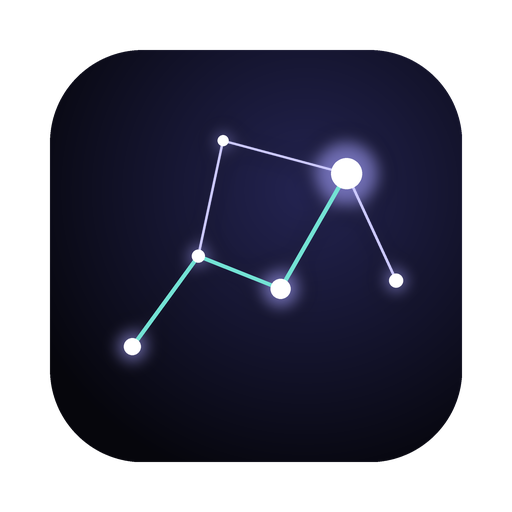
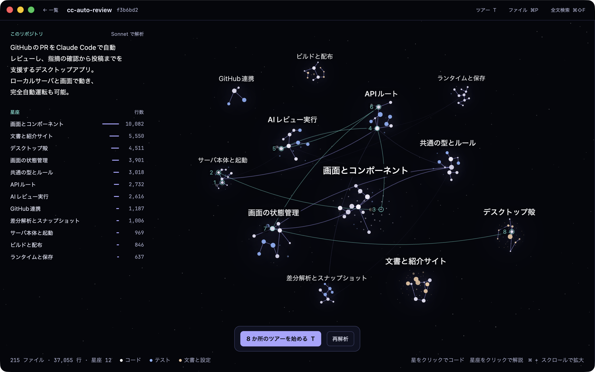
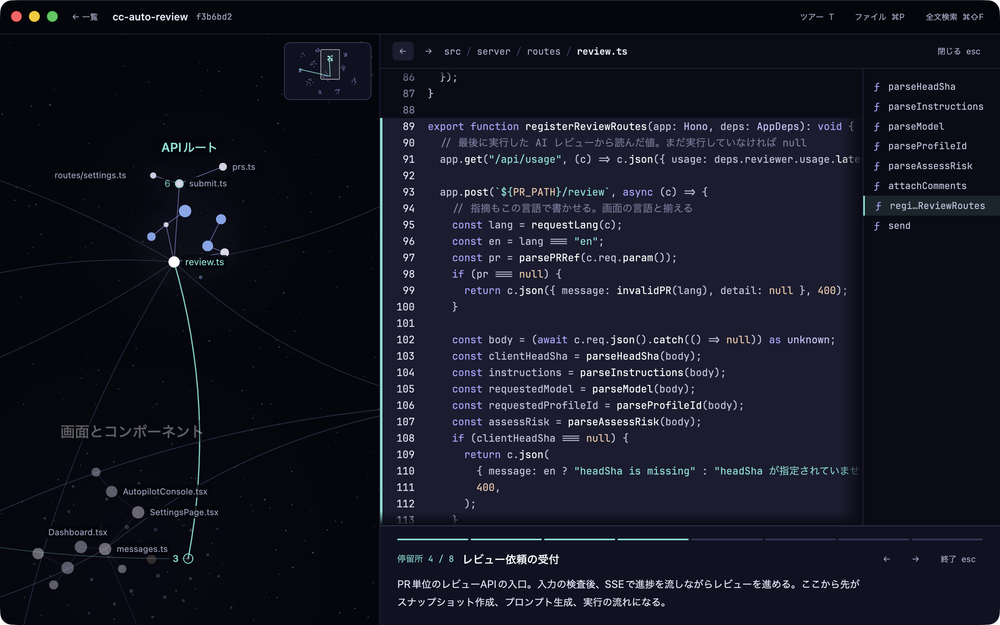
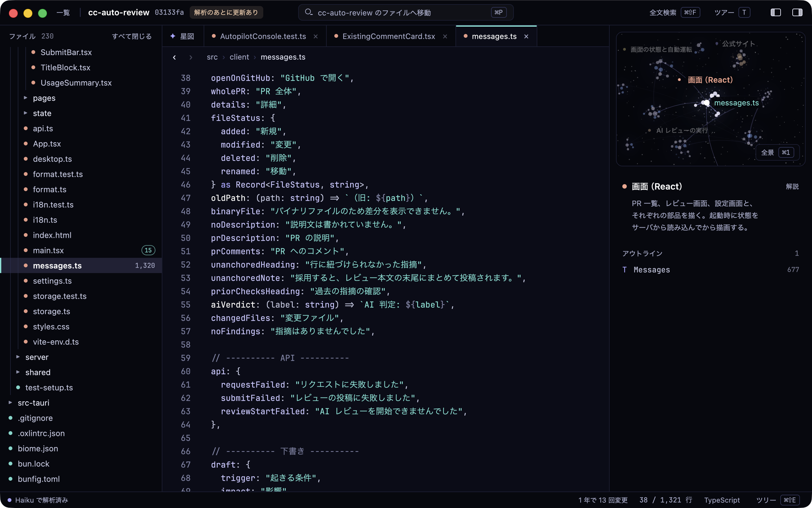

<div align="center">
  

  <h1>CC Code View</h1>

  <p>
    <strong>Dropped into a huge, unfamiliar codebase?</strong>
  </p>
  <p>
    I built a macOS app that turns a repository into a star chart and lets Claude Code show you where to start reading.
  </p>
  <p>
    Files become stars, modules become constellations, and your local <code>claude -p</code> names them and plans a guided tour. Read code in a normal viewer with a file tree and tabs, and always see where you are on the map.
  </p>

  <p>
    <a href="#-features"></a>
    <a href="#-installation"></a>
    <a href="#-usage"></a>
    <a href="#-development"></a>
  </p>
  <p>
    
    
    
    
    <a href="LICENSE"></a>
  </p>

  <p><a href="README.ja.md">日本語の README はこちら</a></p>

  <p>⭐ <strong>If it helps you find your way around a new codebase, a star helps others find it.</strong><br>
  Follow <a href="https://x.com/kara_mage">@kara_mage</a> on X for updates.</p>
</div>

<p align="center">
  
  <br>
  <sub>The whole sky: constellations named by Claude, the tour's route, and the list of constellations.</sub>
</p>

> [!NOTE]
> This is an independent project, not affiliated with, endorsed by, or sponsored by Anthropic. Claude is a trademark of Anthropic, PBC.

## 🌟 Overview

When you join a project, the hard part is not reading a file. It is knowing which file to read, and how it fits with the rest. **CC Code View** answers both with one picture.

- **The star chart** is drawn in seconds without AI. Star size is the amount of code, brightness is how often the file changes, and lines are dependencies.
- **Claude names the constellations** (modules), writes a short description of each, and picks the stops of a **guided tour** in reading order.
- **The code viewer** looks like the editor you already use: file tree, tabs, breadcrumbs, syntax highlighting. A small map on the right always shows where the current file sits in the whole repository.

Everything runs on your Mac with your installed Claude Code. Without Claude Code, the star chart and the code viewer still work.

## 🆚 How it differs

| | CC Code View | Asking a chat AI | Reading in an editor |
|---|---|---|---|
| Big picture | A map of every file, its size, churn and dependencies | A text summary you have to picture yourself | The folder tree |
| Where to start | A guided tour, in order, with explanations next to the code | Depends on what you ask | You decide |
| Where am I now | The current file is highlighted on the map as you read | Lost after a few answers | Only the file path |
| Repository safety | Claude runs read-only in an empty temp dir; repo hooks and `.mcp.json` are ignored | Depends on the tool | Not applicable |

## 📋 Table of Contents

- [🌟 Overview](#-overview)
- [🆚 How it differs](#-how-it-differs)
- [✨ Features](#-features)
- [🚀 Installation](#-installation)
- [📖 Usage](#-usage)
- [⌨️ Keyboard shortcuts](#️-keyboard-shortcuts)
- [🏗 How it works](#-how-it-works)
- [🔒 Security](#-security)
- [⚡ Performance](#-performance)
- [🛠 Development](#-development)
- [🤝 Contributing](#-contributing)
- [📄 License](#-license)
- [🙏 Acknowledgments](#-acknowledgments)

## ✨ Features

### 🌌 A star chart of your repository
- **Size, churn and dependencies at a glance**: star size is lines of code, brightness is how often the file changed in the last year, and lines are imports between files.
- **Drawn without AI**: indexing, layout and dependency resolution run locally in a few seconds, even for 10,000+ files.
- **Zoom and pan** with `⌘` + scroll; click a star to open its code, click a constellation name to read about it.

### 🧭 Guided tours by Claude
- **Constellations with names**: Claude groups files into modules, names them, and writes what each one does.
- **A tour in reading order**: press `T`, then `←` `→`. The camera on the map, the code, and the explanation move together.
- **Deep dives on demand**: open a constellation and press *Generate explanation* to get a longer write-up of that module, saved for next time.
- **Pick a model** wherever AI runs: Claude's default, Fable, Opus, Sonnet or Haiku.

<p align="center">
  
  <br>
  <sub>A tour stop: the map, the code and the explanation stay in sync.</sub>
</p>

### 📖 A code viewer that knows where you are
- **File tree** that follows the file you are reading. Dots are colored by constellation and tour stops are numbered.
- **Tabs and breadcrumbs**: tabs reopen where you left off, and the breadcrumb ends with the function you are in.
- **Location panel**: the current file's star and constellation, the constellation's description, and an outline of functions and types.
- **Syntax highlighting** for Rust, TypeScript, JavaScript, Python and Go, plus JSON, TOML, YAML, CSS, shell and Markdown.
- **Find in file, go to line, simple go-to-definition (`⌘` + click), back/forward history, line selection and copy.**

<p align="center">
  
  <br>
  <sub>Reading code: file tree, tabs, and the map of where you are.</sub>
</p>

### 🔎 Search
- **Fuzzy file search** (`⌘P`) and **full-text search** (`⌘⇧F`) across the repository.

### 🖥 Small and fast native app
- **About 12 MB**, starts in about 150 ms, and renders at 60 fps. Built with Rust and [gpui](https://github.com/zed-industries/zed/tree/main/crates/gpui), the UI framework behind the Zed editor.

## 🚀 Installation

### Prerequisites

- macOS 13 or later (tested on Apple silicon)
- [Rust](https://rustup.rs) stable. The Metal Toolchain is not needed, because the app uses gpui's `runtime_shaders` feature.
- For the AI features: [Claude Code](https://claude.com/claude-code) with `--restricted` support (tested with 2.1.319). The star chart and code viewer work without it.

### Build from source

```bash
git clone https://github.com/karamage/cc-code-view.git
cd cc-code-view
scripts/bundle.sh   # builds target/CC Code View.app
```

Then drag `target/CC Code View.app` into `/Applications`.

> [!IMPORTANT]
> The app is ad-hoc signed and not notarized. If macOS refuses to open it, allow it in **System Settings → Privacy & Security → Open Anyway**.

## 📖 Usage

```
Register a repository → See the star chart → Run AI analysis → Take the tour → Read freely
```

1. **Register a repository**: click *Register* on the home screen, or drop a folder onto the window. Any local Git repository works.
2. **See the star chart**: it appears in a few seconds, without AI. You can already open any file from the tree or the map.
3. **Run AI analysis**: on the star chart tab, pick a model and press `Enter`. Claude reads the repository, names the constellations and plans the tour. Progress shows which file Claude is reading.
4. **Take the tour**: press `T` and move with `←` `→`. `esc` ends the tour.
5. **Read freely**: the map on the right keeps showing where you are. When the repository changes after an analysis, the title bar says so and you can re-analyze.

## ⌨️ Keyboard shortcuts

| Key | Action |
|---|---|
| `⌘P` / `⌘⇧F` | File search / full-text search |
| `⌘F`, `⏎` `⇧⏎`, `esc` | Find in file, next/previous match, close |
| `⌘L` / `⌃G` | Go to line |
| `⌘⇧E`, `↑` `↓` `←` `→` | Focus the file tree, move and expand/collapse |
| `⌘W`, `⌃⇥` `⌃⇧⇥` | Close tab, switch tabs |
| `⌘1` | Go to the star chart tab |
| `⌘B` / `⌘⇧L` | Toggle the file tree / the right panel |
| `Enter` | Start AI analysis (on the star chart tab) |
| `T`, `←` `→`, `esc` | Start, move through, and end the tour |
| `⌘` + scroll, `⌘=` `⌘-` `⌘0` | Zoom the map, reset to the whole sky |
| `⌘` + click | Go to definition |
| `⌘[` `⌘]` | Back / forward in history |
| Drag, `⌘C` | Select lines, copy |
| `⌘⇧O` | Back to the repository list |

## 🏗 How it works

```
CC Code View.app
├── ccv-core   walks the repo, extracts symbols, resolves imports, reads git churn,
│              groups files, lays out the stars, highlights code, searches, saves state
├── ccv-ai     runs `claude -p` read-only and validates its structured output
└── app        the gpui UI: home, workspace, file tree, code view, star map, tour
```

- The star chart comes only from `ccv-core`: file walking, symbol extraction, import resolution, `git log` churn and a deterministic layout.
- AI analysis sends Claude a prompt and a JSON schema. The result is validated against the repository, so a constellation or tour stop that points to a file that does not exist is dropped.
- Analyses are saved per repository and commit, so reopening a repository is instant.

## 🔒 Security

A cloned repository is treated as untrusted input.

1. **Read-only Claude**: Claude runs in an empty temporary directory and gets the repository through `--add-dir`. Its only tools are `Read`, `Grep` and `Glob`; it cannot write files or run commands. Reads and writes outside those directories are blocked.
2. **Repository config is ignored**: with `--restricted` and `--strict-mcp-config`, the repository's `.claude/` hooks and `.mcp.json` are never loaded.
3. **Secrets are not sent**: files that Claude reads go to Anthropic's API, so `.env`, private keys and credential files are denied (see [`crates/ai/src/command.rs`](crates/ai/src/command.rs)). The check is by file name, so secrets stored under other names are not caught.
4. **Output is validated and shown as plain text**: entries that point outside the repository are dropped, and no Markdown or HTML is rendered.
5. **Nothing is written to your repository**: app data lives in `~/Library/Application Support/cc-code-view/`.
6. **No telemetry**: the app itself makes no network requests and sends no usage data. AI analysis goes through the `claude` command you installed.

The isolation is tested against the real `claude`:

```bash
cargo test -p ccv-ai --test security -- --ignored   # uses real claude and a little of your usage
```

See [SECURITY.md](SECURITY.md) to report a vulnerability.

## ⚡ Performance

Measured on an Apple M1 with `scripts/measure.sh` ([details](docs/quality/performance.md)):

| Metric | Result |
|---|---|
| Cold start | about 150 ms |
| Indexing 12,000 files | 1.5 s |
| App size | 12 MB |
| Memory while viewing 12,000 files | 169 MB |
| Frame time | p50 16.7 ms, p99 17.7 ms (60 fps) |

## 🛠 Development

### Tech stack

- **Language**: Rust (edition 2024)
- **UI**: [gpui](https://github.com/zed-industries/zed/tree/main/crates/gpui)
- **AI**: [Claude Code](https://claude.com/claude-code) (`claude -p` with structured output)

### Project structure

```
cc-code-view/
├── crates/
│   ├── core/      # indexing, dependencies, churn, grouping, layout, highlighting, search, storage
│   ├── ai/        # claude runner, prompts, schemas, validation, security tests
│   └── app/       # gpui UI (home, workspace, tree, code view, star map, tour)
├── scripts/       # bundling, screenshot capture, UI driving, measurement
└── docs/          # images, quality rubric and records, design spec and plan
```

### Commands

```bash
cargo test --workspace
cargo clippy --workspace --all-targets -- -D warnings
scripts/bundle.sh                                # build the .app
scripts/capture.sh <out-dir> <repo>              # capture every UI state (BIN=target/debug/cc-code-view for a dev build)
scripts/drive-viewer.sh <out-dir> <repo>         # drive the tree, search and go-to-line with real input
scripts/measure.sh [repo]                        # measure performance
```

## 🤝 Contributing

Issues and pull requests are welcome. Please run `cargo test --workspace` and `cargo clippy` before opening a PR.

Areas where help is especially welcome:

- 🐛 Bug reports and fixes
- 🎨 Syntax highlighting and import resolution for more languages
- 🌐 An English UI (the UI is currently Japanese)
- 🐧 Linux and 🪟 Windows support (gpui runs on both)
- 📦 Signed and notarized releases

## 📄 License

MIT. See [LICENSE](LICENSE).

The bundled JetBrains Mono font is under the SIL Open Font License ([`crates/app/assets/fonts/OFL.txt`](crates/app/assets/fonts/OFL.txt)). The text input is based on a gpui example (Apache-2.0, see [`LICENSES/`](LICENSES/)). The nebula on the home screen was made with image generation.

## 🙏 Acknowledgments

- [Claude Code](https://claude.com/claude-code) by Anthropic, which names the constellations and plans the tours
- [gpui](https://github.com/zed-industries/zed/tree/main/crates/gpui) by Zed Industries, which makes a fast native UI in Rust possible
- [JetBrains Mono](https://github.com/JetBrains/JetBrainsMono)
- [CC Auto Review](https://github.com/karamage/cc-auto-review), a sister app that reviews pull requests with Claude Code

---

<div align="center">
  <a href="https://github.com/karamage/cc-code-view/issues">Report Bug</a>
  ·
  <a href="https://github.com/karamage/cc-code-view/issues">Request Feature</a>
</div>
